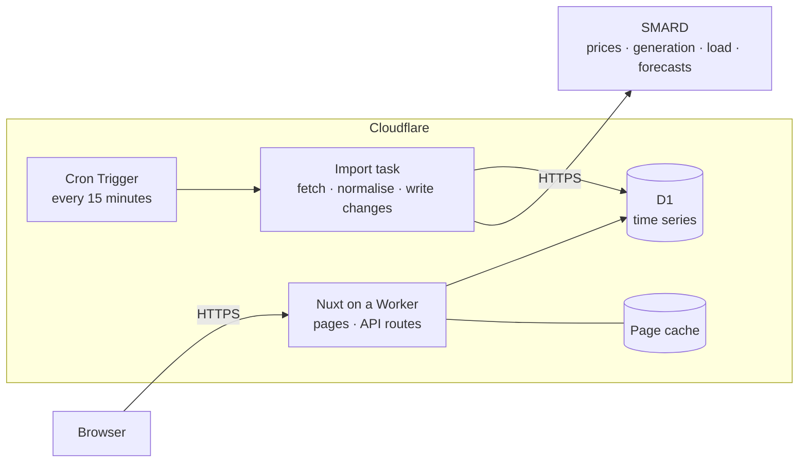

# Stromfenster

**When is electricity in Germany cheap and clean?** A dashboard on public market data: day-ahead prices, the generation mix, and the best time window for running an appliance.

> **Status:** Phase 0 (foundation). The project builds, is tested and runs in the Workers runtime locally. It is not deployed yet, and there is no data pipeline or chart yet. See the [roadmap](docs/ROADMAP.md).

## Planned features

- **Prices for today and tomorrow** in 15-minute resolution, as soon as the day-ahead auction is published
- **Best window**: the cheapest and the cleanest time to run something for a given duration ("two hours for the washing machine")
- **Generation mix and CO₂ estimate**, with the method and its limits explained on the page
- **Server-rendered charts**: the chart is in the HTML, so it is visible without JavaScript
- **German and English**, light and dark mode, WCAG 2.1 AA

## Tech stack

| Area      | Choice                                                  |
| --------- | ------------------------------------------------------- |
| Framework | Nuxt 4, Vue 3 (Composition API), TypeScript (strict)    |
| Server    | Nitro server routes and scheduled tasks                 |
| Hosting   | Cloudflare Workers, D1 for the time series (planned)    |
| Data      | SMARD, the Bundesnetzagentur's market data platform     |
| Testing   | Vitest (unit and Nuxt runtime), `workerd` for the build |
| Quality   | ESLint, Prettier, GitHub Actions CI, Dependabot         |

## Architecture

Planned for v1. Only the Worker with a start page and a health route exists so far.



- **The import is independent of visitors.** A scheduled task fetches new values, normalises them and writes only what changed.
- **Pages read from the database**, never from the source directly, so a slow or unreachable source does not break the page.
- **Rendered pages are cached** and revalidated when new data arrives.

The reasoning behind these choices is recorded in [Architecture Decision Records](docs/adr).

## Data and attribution

Market data comes from [SMARD](https://www.smard.de), published by the Bundesnetzagentur under [CC BY 4.0](https://creativecommons.org/licenses/by/4.0/). Attribution: Bundesnetzagentur | SMARD.de.

## Project structure

```
app/          Pages, components and styles
server/
  api/        Server routes
  utils/      Server-side logic
test/
  unit/       Plain unit tests
  nuxt/       Tests inside a Nuxt runtime
docs/
  adr/        Architecture Decision Records
  ROADMAP.md
```

## Getting started

Requirements: Node.js 24+ and pnpm. No accounts or credentials are needed.

```bash
pnpm install
pnpm dev
```

- App: http://localhost:3000
- Health check: http://localhost:3000/api/health

## Scripts

| Command          | What it does                                                      |
| ---------------- | ----------------------------------------------------------------- |
| `pnpm dev`       | Start the app in watch mode                                       |
| `pnpm build`     | Build the Worker for production                                   |
| `pnpm preview`   | Run the production build locally in the Workers runtime           |
| `pnpm test`      | Run all tests                                                     |
| `pnpm lint`      | Lint the codebase                                                 |
| `pnpm typecheck` | Type-check app and server code                                    |
| `pnpm check`     | Everything CI runs after formatting: lint, typecheck, test, build |
| `pnpm format`    | Format the codebase with Prettier                                 |

## Testing

| Layer             | Tool                      | What it covers so far                    |
| ----------------- | ------------------------- | ---------------------------------------- |
| Server-side logic | Vitest                    | The health status                        |
| Pages             | Vitest + Nuxt environment | The start page renders inside a Nuxt app |

More layers follow with the code they test: the import against recorded SMARD responses, server routes against D1 in `workerd`, end-to-end and accessibility tests with Playwright and axe-core.

## License

[MIT](LICENSE)
