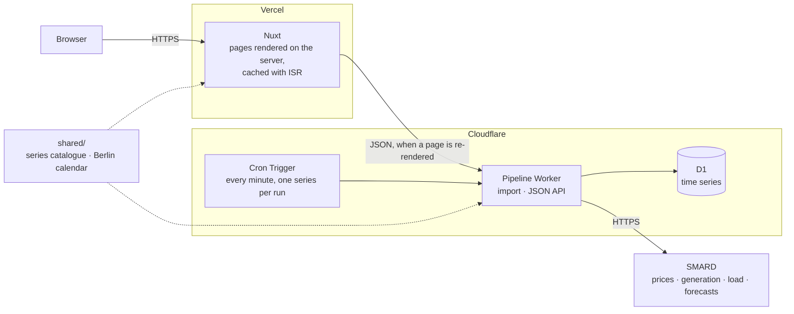

# Stromfenster

**When is electricity in Germany cheap and clean?** A dashboard on public market data: day-ahead prices, the generation mix, and the best time window for running an appliance.

**Live:** [stromfenster.vercel.app](https://stromfenster.vercel.app) · Data API: [stromfenster.plan-werk.workers.dev](https://stromfenster.plan-werk.workers.dev) · What the import is doing: [/api/status](https://stromfenster.plan-werk.workers.dev/api/status) · A day of data: [/api/days/2026-11-14](https://stromfenster.plan-werk.workers.dev/api/days/2026-11-14) (complete days start on 13 November 2026)

> **Status:** Phase 4 (languages and SEO). The site is in German and English, with one page per day, a sitemap, structured data and link previews. The accessibility and performance passes follow in Phase 5. See the [roadmap](docs/ROADMAP.md).

## Features

- **Prices for today and tomorrow** in 15-minute resolution, as soon as the day-ahead auction is published
- **Best window**: the cheapest time, and the time with the most wind and solar, to run something for 1 to 4 hours
- **Generation today** by source, as it is measured, with an **estimate of its CO₂ emissions** from published emission factors ([ADR 7](docs/adr/0007-co2-estimate-from-the-generation-mix.md))
- **A methodology page**: what is measured, what is estimated, what is left out, and where each number comes from
- **German and English**: German at [/](https://stromfenster.vercel.app), English at [/en](https://stromfenster.vercel.app/en), with `hreflang` links between them ([ADR 8](docs/adr/0008-german-and-english.md))
- **One page per day**, e.g. [/tag/2026-11-15](https://stromfenster.vercel.app/tag/2026-11-15): prices with their lowest and highest quarter hour, generation, CO₂ and renewable share, with links to the days around it ([ADR 9](docs/adr/0009-day-pages-and-search.md))
- **Found and shared well**: a sitemap in both languages, a schema.org `Dataset` on every data page, and a link preview image
- **Server-rendered charts**: the charts and the recommendation are in the HTML and work without JavaScript, including the choice of duration ([ADR 6](docs/adr/0006-server-rendered-svg-charts.md))
- **A table for every chart**, light and dark mode

Planned: WCAG 2.1 AA checked with axe, Lighthouse on the production build.

## Tech stack

| Area     | Choice                                                                                   |
| -------- | ---------------------------------------------------------------------------------------- |
| Website  | Nuxt 4, Vue 3 (Composition API), TypeScript (strict), `@nuxtjs/i18n`, on Vercel with ISR |
| Charts   | SVG rendered by Vue on the server, no chart library, plain CSS                           |
| Pipeline | A Cloudflare Worker without a framework: Cron Trigger, D1 (SQLite), JSON API             |
| Data     | SMARD, the Bundesnetzagentur's market data platform                                      |
| Testing  | Vitest; the Worker with D1 in `workerd`                                                  |
| Quality  | ESLint, Prettier, GitHub Actions CI, Dependabot                                          |

## Architecture

Both halves are deployed.



- **The import is independent of visitors.** A Cron Trigger starts it every minute. Each run reads the current file of one series from SMARD, compares it with the database and writes only quarter hours that are new or were corrected ([ADR 3](docs/adr/0003-incremental-import-into-d1.md)).
- **One series per run.** Importing all 17 series at once took about four times the CPU time a Worker on the free plan may use per invocation, so they take turns; each series is imported every 17 minutes ([ADR 5](docs/adr/0005-one-series-per-run.md)).
- **The pipeline and the pages are split along their CPU cost.** A Cloudflare Worker on the free plan has 10 ms of CPU time per invocation. The import and the API fit a small Worker; starting Nuxt in the same Worker took four to seven times that. The pages are therefore rendered on Vercel ([ADR 4](docs/adr/0004-pages-on-vercel-pipeline-on-cloudflare.md)).
- **Pages read from the pipeline's API, never from the source**, so a slow or unreachable SMARD does not break the page. Vercel caches the rendered page and renders it again at most every five minutes; if the API does not answer, the page says so with a 503 that is not cached.
- **Time is stored in UTC and read in Berlin time.** A day in the API has 96 quarter hours, or 92 and 100 on the days the clocks change.

The reasoning behind these choices is recorded in [Architecture Decision Records](docs/adr).

## Data and attribution

Market data comes from [SMARD](https://www.smard.de), published by the Bundesnetzagentur under [CC BY 4.0](https://creativecommons.org/licenses/by/4.0/). Attribution: Bundesnetzagentur | SMARD.de. Why SMARD, and what it does not provide, is in [ADR 2](docs/adr/0002-smard-as-data-source.md).

The pipeline imports 17 series in 15-minute resolution: the day-ahead price, generation per energy source, load, and the forecasts for load, wind and solar.

## API

Served by the pipeline Worker. Responses are JSON and may be read from any origin.

| Route                      | Returns                                                                                                    |
| -------------------------- | ---------------------------------------------------------------------------------------------------------- |
| `GET /api/days/YYYY-MM-DD` | All series for one calendar day in Berlin, one value per quarter hour                                      |
| `GET /api/status`          | The last import run, a summary of the runs of the 48 hours before it, and the newest value of every series |
| `GET /api/health`          | A liveness check that does not touch the database                                                          |

## Project structure

```
app/            The website (Nuxt)
  pages/        The start page, the methodology and one page per day
  components/   Charts, the recommendation, the chart card, the language switch, the methodology in both languages
  composables/  Data access and the clock of the page
  utils/        Chart geometry and formatting
worker/         The data pipeline (Cloudflare Worker)
  src/          Import, SMARD client, database access, API routes
  migrations/   D1 schema
i18n/locales/   Messages in German and English
shared/         Used by both: series catalogue, Berlin calendar, best window, generation mix, CO₂ estimate
server/         The sitemap (the website's only server route)
scripts/        Records SMARD responses as test fixtures; renders the link preview image
test/
  unit/         Plain unit tests
  nuxt/         Tests inside a Nuxt runtime
  worker/       The Worker with D1 in workerd
  site/         The built website: the HTML it sends
  fixtures/     Recorded responses from SMARD and from the deployed API
docs/
  adr/          Architecture Decision Records
  ROADMAP.md
```

## Getting started

Requirements: Node.js 24+ and pnpm. No accounts or credentials are needed.

```bash
pnpm install
pnpm dev            # the website on http://localhost:3000
```

To run the pipeline locally as well:

```bash
pnpm db:migrate     # creates the local D1 database
pnpm dev:worker     # the Worker on http://localhost:8787
```

- Run the import once: `curl "http://localhost:8787/__scheduled?cron=*+*+*+*+*"`
- What it imported: http://localhost:8787/api/status

The local database lives in `worker/.wrangler/`. `/__scheduled` only exists in local development; on Cloudflare the Cron Trigger is the only way to start the import. Locally a run imports all series at once (`IMPORT_ALL_SERIES`), because no CPU limit applies there; deployed, it imports the one that is due.

## Scripts

| Command            | What it does                                                        |
| ------------------ | ------------------------------------------------------------------- |
| `pnpm dev`         | Start the website in watch mode                                     |
| `pnpm dev:worker`  | Start the pipeline Worker locally                                   |
| `pnpm build`       | Build the website for production                                    |
| `pnpm test`        | Run the unit tests and the tests inside a Nuxt runtime              |
| `pnpm test:worker` | Run the Worker with D1 in `workerd`                                 |
| `pnpm test:site`   | Start the built website and check the HTML it sends (needs a build) |
| `pnpm lint`        | Lint the codebase                                                   |
| `pnpm typecheck`   | Type-check the website, the Worker, tests and scripts               |
| `pnpm check`       | Everything CI runs after formatting, including both test suites     |
| `pnpm db:migrate`  | Apply the migrations to the local D1 database                       |
| `pnpm format`      | Format the codebase with Prettier                                   |

## Deployment

**Pipeline Worker → Cloudflare.** GitHub Actions deploys every push to `main` after the checks are green:

1. create the D1 database if it does not exist yet (first deployment only),
2. apply the migrations to it,
3. deploy the Worker with its Cron Trigger.

Migrations run before the new Worker goes live, so it never meets an old schema. The job needs the repository secrets `CLOUDFLARE_API_TOKEN` (permission to edit Workers scripts and D1) and `CLOUDFLARE_ACCOUNT_ID`; without them it is skipped with a notice. The database has no id in `worker/wrangler.jsonc`: Wrangler finds it by its name. `pnpm db:migrate:remote` and `pnpm deploy:worker` do the same by hand.

**Website → Vercel.** Vercel builds the Nuxt app from this repository on every push; pull requests get preview deployments. No adapter or preset is configured here.

## Testing

Each layer is tested where it runs. The only thing replaced is SMARD itself, by responses recorded from it ([`test/fixtures/smard`](test/fixtures/smard)).

| Layer                 | Tool                      | What it covers                                                                                                                                                                                                                         |
| --------------------- | ------------------------- | -------------------------------------------------------------------------------------------------------------------------------------------------------------------------------------------------------------------------------------- |
| Calendar and parsing  | Vitest                    | Berlin days and weeks including clock changes, checked against every week SMARD lists; parsing of recorded responses; the summary of import runs                                                                                       |
| Import, database, API | Vitest + `workerd` + D1   | The Worker: a Cron Trigger imports a recording, a second run writes nothing, a later recording only its changes; failing series; the API routes                                                                                        |
| Dashboard logic       | Vitest                    | Best window against a brute-force check, timeline, generation mix, CO₂ estimate, chart geometry, formatting; on days recorded from the deployed API                                                                                    |
| Pages and components  | Vitest + Nuxt environment | Both languages: the pages and the charts rendered for the recorded evening, the methodology tables against the definitions the calculations use, the state when the data API fails                                                     |
| Server-rendered HTML  | Vitest + the built server | What arrives without JavaScript, in both languages: recommendations, charts, the duration choice by CSS, `hreflang` and canonical links, the methodology at its address in each language; 503 and `no-store` when the data API is down |

End-to-end and accessibility tests with Playwright and axe-core follow in Phase 5.

## License

[MIT](LICENSE)
