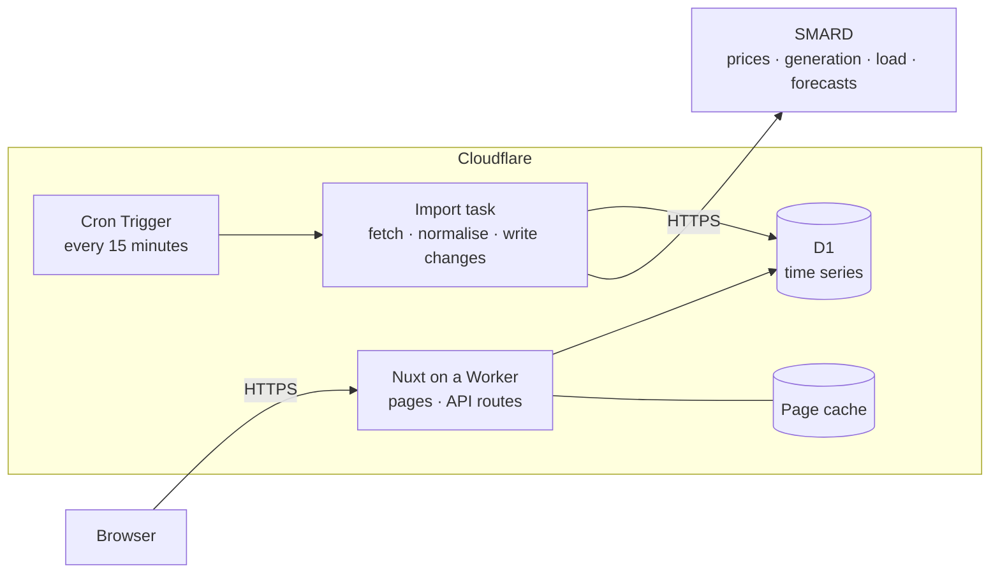

# Stromfenster

**When is electricity in Germany cheap and clean?** A dashboard on public market data: day-ahead prices, the generation mix, and the best time window for running an appliance.

> **Status:** Phase 1 (data pipeline). The import from SMARD, the database and the API work and are tested in the Workers runtime locally. Nothing is deployed yet, and there are no charts yet. See the [roadmap](docs/ROADMAP.md).

## Planned features

- **Prices for today and tomorrow** in 15-minute resolution, as soon as the day-ahead auction is published
- **Best window**: the cheapest and the cleanest time to run something for a given duration ("two hours for the washing machine")
- **Generation mix and CO₂ estimate**, with the method and its limits explained on the page
- **Server-rendered charts**: the chart is in the HTML, so it is visible without JavaScript
- **German and English**, light and dark mode, WCAG 2.1 AA

## Tech stack

| Area      | Choice                                               |
| --------- | ---------------------------------------------------- |
| Framework | Nuxt 4, Vue 3 (Composition API), TypeScript (strict) |
| Server    | Nitro server routes, import task on a Cron Trigger   |
| Hosting   | Cloudflare Workers, D1 (SQLite) for the time series  |
| Data      | SMARD, the Bundesnetzagentur's market data platform  |
| Testing   | Vitest; the built Worker with D1 in `workerd`        |
| Quality   | ESLint, Prettier, GitHub Actions CI, Dependabot      |

## Architecture

The import, the database and the API exist; the dashboard pages and the page cache are planned.



- **The import is independent of visitors.** Every 15 minutes a Cron Trigger starts a task that reads the current files from SMARD, compares them with the database and writes only quarter hours that are new or were corrected ([ADR 3](docs/adr/0003-incremental-import-into-d1.md)).
- **Pages read from the database**, never from the source directly, so a slow or unreachable source does not break the page.
- **Time is stored in UTC and read in Berlin time.** A day in the API has 96 quarter hours, or 92 and 100 on the days the clocks change.
- **Rendered pages will be cached** and revalidated when new data arrives.

The reasoning behind these choices is recorded in [Architecture Decision Records](docs/adr).

## Data and attribution

Market data comes from [SMARD](https://www.smard.de), published by the Bundesnetzagentur under [CC BY 4.0](https://creativecommons.org/licenses/by/4.0/). Attribution: Bundesnetzagentur | SMARD.de. Why SMARD, and what it does not provide, is in [ADR 2](docs/adr/0002-smard-as-data-source.md).

The app imports 17 series in 15-minute resolution: the day-ahead price, generation per energy source, load, and the forecasts for load, wind and solar.

## API

| Route                      | Returns                                                                                              |
| -------------------------- | ---------------------------------------------------------------------------------------------------- |
| `GET /api/days/YYYY-MM-DD` | All series for one calendar day in Berlin, one value per quarter hour                                |
| `GET /api/status`          | The last import, a summary of the imports of the last 48 hours, and the newest value of every series |
| `GET /api/health`          | A liveness check that does not touch the database                                                    |

## Project structure

```
app/          Pages, components and styles
server/
  api/        Server routes
  tasks/      The import task
  plugins/    Connects the Cron Trigger to the task
  utils/      SMARD client, import, database access
shared/       Series catalogue and Berlin calendar maths, used by server and app
migrations/   D1 schema
scripts/      Records SMARD responses as test fixtures
test/
  unit/       Plain unit tests
  nuxt/       Tests inside a Nuxt runtime
  worker/     The built Worker with D1 in workerd
  fixtures/   Recorded SMARD responses
docs/
  adr/        Architecture Decision Records
  ROADMAP.md
```

## Getting started

Requirements: Node.js 24+ and pnpm. No accounts or credentials are needed.

```bash
pnpm install
pnpm db:migrate   # creates the local D1 database
pnpm dev
```

- App: http://localhost:3000
- Run the import once: http://localhost:3000/_nitro/tasks/import
- What it imported: http://localhost:3000/api/status

The local database lives in `.wrangler/`. In development the import runs when you open the task URL; the Cron Trigger only exists in the Workers runtime.

## Scripts

| Command            | What it does                                                    |
| ------------------ | --------------------------------------------------------------- |
| `pnpm dev`         | Start the app in watch mode                                     |
| `pnpm build`       | Build the Worker for production                                 |
| `pnpm preview`     | Run the production build locally in the Workers runtime         |
| `pnpm test`        | Run the unit tests and the tests inside a Nuxt runtime          |
| `pnpm test:worker` | Run the built Worker with D1 in `workerd` (needs a build)       |
| `pnpm lint`        | Lint the codebase                                               |
| `pnpm typecheck`   | Type-check app, server, tests and scripts                       |
| `pnpm check`       | Everything CI runs after formatting, including both test suites |
| `pnpm db:migrate`  | Apply the migrations to the local D1 database                   |
| `pnpm format`      | Format the codebase with Prettier                               |

## Deployment

GitHub Actions deploys every push to `main` after the checks are green:

1. build the Worker,
2. create the D1 database if it does not exist yet (first deployment only),
3. apply the migrations to it,
4. deploy the Worker with its Cron Trigger.

Migrations run before the new Worker goes live, so it never meets an old schema. The job needs the repository secrets `CLOUDFLARE_API_TOKEN` (permission to edit Workers scripts and D1) and `CLOUDFLARE_ACCOUNT_ID`; without them it is skipped with a notice.

The database has no id in `wrangler.jsonc`: Wrangler finds it by its name. `pnpm db:migrate:remote` and `pnpm run deploy` do the same by hand.

## Testing

Each layer is tested where it runs. The only thing replaced is SMARD itself, by responses recorded from it ([`test/fixtures/smard`](test/fixtures/smard)).

| Layer                 | Tool                      | What it covers                                                                                                                                        |
| --------------------- | ------------------------- | ----------------------------------------------------------------------------------------------------------------------------------------------------- |
| Calendar and parsing  | Vitest                    | Berlin days and weeks including clock changes, checked against every week SMARD lists; parsing of recorded responses                                  |
| Import, database, API | Vitest + `workerd` + D1   | The built Worker: a Cron Trigger imports a recording, a second run writes nothing, a later recording only its changes; failing series; the API routes |
| Pages                 | Vitest + Nuxt environment | The start page renders inside a Nuxt app                                                                                                              |

End-to-end and accessibility tests with Playwright and axe-core follow with the dashboard.

## License

[MIT](LICENSE)
